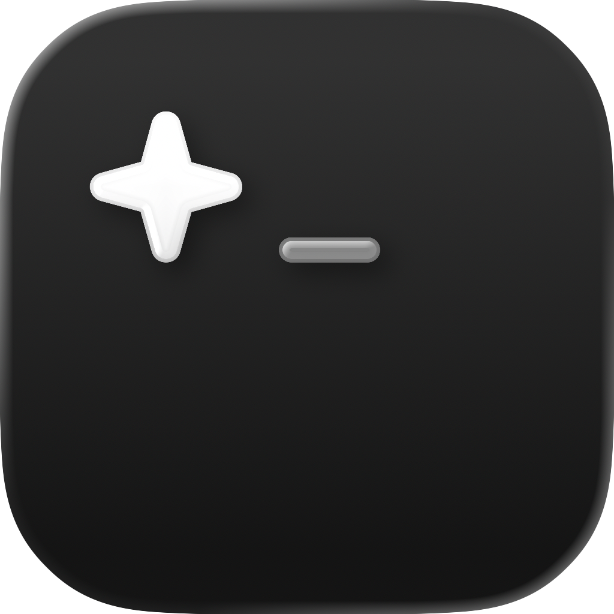

# Ultra para Windows 11

Terminal agéntico de escritorio. Una ventana con un terminal real, el agente
de código que elijas (Claude Code, Codex u otro CLI), el árbol de archivos,
el contexto fijado y git.

Esta versión está hecha para **Windows 11**: PowerShell y ConPTY, icono de la
barra de tareas, bandeja de notificación, material Mica, botones nativos de
la barra de título y un instalador NSIS. El logo es el de Ultra.

> Electron · xterm.js · React · TypeScript · Tailwind

## Qué incluye

- **Terminal real** — `xterm.js` + `node-pty` (ConPTY). Una sesión viva por
  pestaña, y sigue viva al cambiar de proyecto.
- **Tu agente** — lanza `claude`, `codex` o un comando propio desde la
  cabecera. Cada uno corre en el directorio del proyecto. En Windows los
  shims `.cmd` (npm) se resuelven con `cmd.exe`.
- **Proyectos y sesiones** — abre carpetas, varias shells o agentes por
  proyecto, todo persistido.
- **Archivos** — árbol en vivo. Vista previa, mención `@archivo` al agente,
  mostrar en el Explorador, editar en VS Code / Cursor / otro editor, o
  enviar a la papelera.
- **Contexto** — fija archivos o carpetas y envíalos al terminal activo.
- **Git** — init, stage, commit, ramas, fetch/pull/push, diffs e historial.
- **Temas** — oscuro y claro, sobre Mica en Windows 11.
- **Icono** — el logo de Ultra en el `.exe`, la barra de tareas, el
  instalador, la bandeja y la pantalla de arranque. Mientras un agente
  trabaja, el icono de la barra de tareas y la bandeja lo indican.

## Requisitos

- Windows 11
- [Node.js](https://nodejs.org/) 20 o superior
- Git en el PATH (Git for Windows) para el panel de control de código
- El CLI del agente que quieras usar (`claude`, `codex`, …), también en el PATH

## Desarrollo

```bash
npm install       # recompila node-pty contra el ABI de Electron
npm run dev       # arranca con recarga en caliente
npm run typecheck
npm test
npm run build
```

## Instalador

En Windows:

```bash
npm run dist:win
```

Genera un instalador NSIS en `release/` (`Ultra-<versión>-x64.exe` en un
Windows 11 de 64 bits), con acceso directo en el escritorio y en el menú
Inicio, y el logo como icono del programa y del desinstalador.

El instalador no está firmado. Windows SmartScreen puede pedir confirmación
la primera vez que lo abras. Para evitarlo hace falta un certificado de
firma de código.

## Atajos

En Windows los atajos usan Ctrl: Ctrl+D sesión nueva, Ctrl+W cerrar sesión,
Ctrl+1…9 cambiar de proyecto, Ctrl+F buscar en el editor, Ctrl+S guardar.
Alt muestra la barra de menú (Archivo, Sesión, Edición, Vista, Ventana).

## Arquitectura

- **main** — proceso de Electron: PTY, archivos, git, lanzamiento de agentes
  y editores, bandeja e icono de la barra de tareas.
- **preload** — puente tipado `window.api` (`contextIsolation` activo).
- **renderer** — React. El estado de Zustand se guarda en
  `userData/projects.json`.

Ultra no reimplementa ningún agente. Lanza el CLI que ya tengas, con tu
PATH, tus credenciales y una consola real.

El proyecto original para macOS es [petit-software/ultra](https://github.com/petit-software/ultra).
Esta copia adapta esa aplicación a Windows 11 y conserva su licencia MIT.
